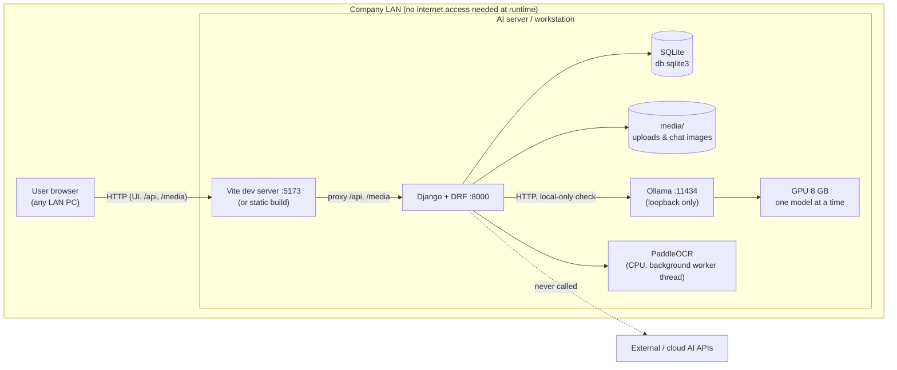
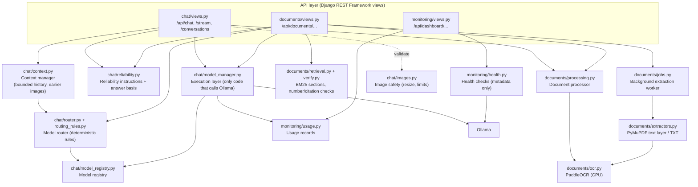
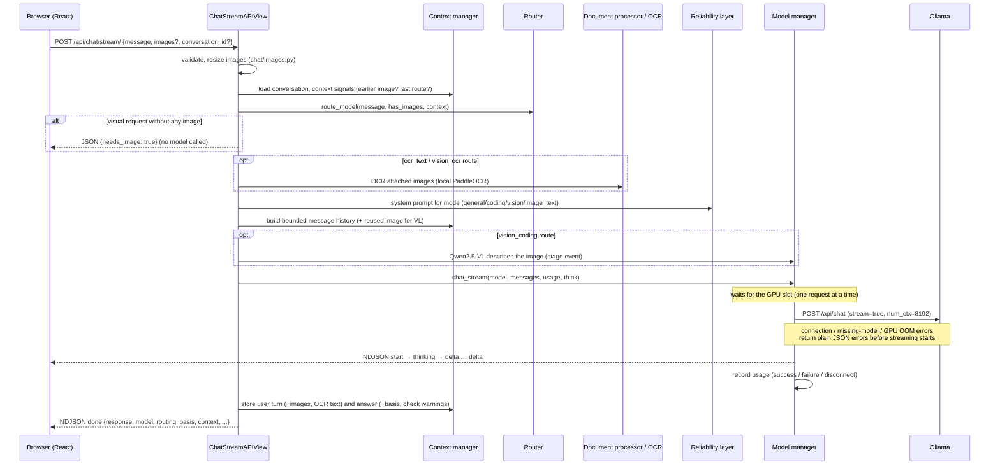
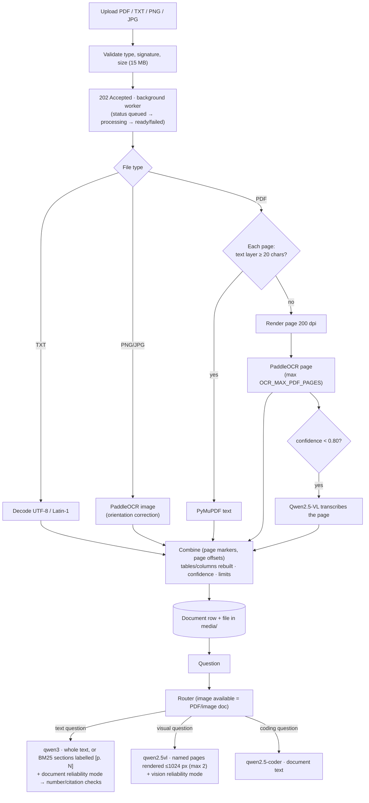
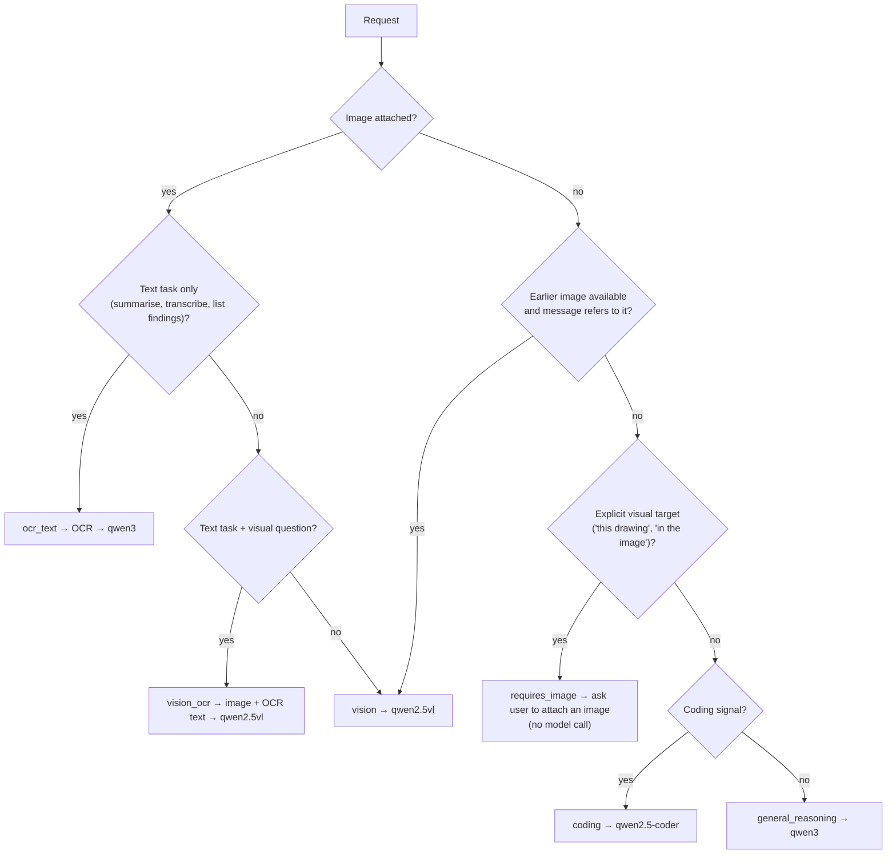

# MRPL Local AI — Sovereign On-Premise AI Workbench

A private, fully on-premise AI workbench for an industrial environment. Users chat with local
large language models, ask questions about documents and scanned reports, analyse images, and
generate code. **All AI inference runs on local hardware through [Ollama](https://ollama.com);
no prompt, document or image is ever sent to an external or cloud AI service.**

| | |
|---|---|
| **Frontend** | React 18 + Vite 5 single-page app (chat, Document Assistant, Dashboard) |
| **Backend** | Django 6.1 + Django REST Framework 3.18 (Python 3.12) |
| **Inference** | Ollama 0.33 serving three local models: `qwen3:8b`, `qwen2.5-coder:7b`, `qwen2.5vl:7b` |
| **OCR** | PaddleOCR 3.7 (PaddlePaddle 3.3, CPU) for scanned PDFs and images |
| **Storage** | SQLite (metadata, conversations, usage records) + local `media/` folder (uploads) |
| **Target hardware** | One workstation/server with an 8 GB NVIDIA GPU, 16 GB RAM, serving LAN clients |
| **Tests** | 188 automated backend tests + a 12-step headless-browser smoke test (`tools/ui_smoke.py`) |

> **Status:** working prototype, tested end to end on the development machine. Authentication and
> production deployment hardening are **not implemented yet** (out of scope for now); long
> documents use keyword (BM25) section retrieval, not a vector database — see
> [Limitations & roadmap](#20-limitations--roadmap).

---

## Table of contents

1. [What it does](#1-what-it-does)
2. [Development phases](#2-development-phases)
3. [Architecture](#3-architecture)
4. [Technology stack](#4-technology-stack)
5. [Local AI models](#5-local-ai-models)
6. [Resource requirements — server](#6-resource-requirements--server)
7. [Resource requirements — client](#7-resource-requirements--client)
8. [Installation & setup](#8-installation--setup)
9. [Configuration reference](#9-configuration-reference)
10. [Using the workbench](#10-using-the-workbench)
11. [API reference](#11-api-reference)
12. [Model routing](#12-model-routing)
13. [Conversation context](#13-conversation-context)
14. [Documents & OCR pipeline](#14-documents--ocr-pipeline)
15. [Response reliability (hallucination reduction)](#15-response-reliability-hallucination-reduction)
16. [Monitoring: usage dashboard, system status & model health](#16-monitoring-usage-dashboard-system-status--model-health)
17. [Security & privacy](#17-security--privacy)
18. [Testing](#18-testing)
19. [Research & experimental findings](#19-research--experimental-findings)
20. [Limitations & roadmap](#20-limitations--roadmap)
21. [Operations & troubleshooting](#21-operations--troubleshooting)
22. [Repository structure](#22-repository-structure)
23. [References](#23-references)

---

## 1. What it does

### General Chat
- ChatGPT/Claude-style interface: sidebar with conversation history (paged, *Show more*),
  search, rename, delete, collapsible sidebar (top-left toggle, `Ctrl/⌘+Shift+S`),
  light/dark/system theme.
- **English / हिन्दी:** the whole interface can be switched to Hindi (EN / हिं switch in the
  sidebar footer); answers then come in Hindi too (code, units and quoted text stay unchanged).
- **Automatic model routing** — a deterministic router picks the right local model per request
  (general reasoning → Qwen3, coding → Qwen2.5-Coder, images → Qwen2.5-VL), including paraphrased
  coding requests ("my loop never ends"), pasted code and Hindi keywords. An image + coding request
  runs a **two-step chain**: Qwen2.5-VL describes the image, then Qwen2.5-Coder writes the code.
  Manual model selection is also available.
- **Fast by default:** Qwen3 answers directly; a **Think deeper** toggle turns on step-by-step
  reasoning for hard questions. Models stay loaded for 30 min and are pre-loaded (warm-up) when
  the page opens, the model changes or an image is attached. While waiting the answer shows what
  is happening (*Loading Qwen3 8B into GPU memory · 4s*, *Reading the image…*).
- **Streaming answers** (token by token), Markdown rendering (headings, lists, tables, quotes),
  code blocks with syntax highlighting (22 built-in languages, 37 more loaded on first use) and a
  *Copy* button. Per answer: *Copy*, *Regenerate* (any stored answer, not only the last), 👍 / 👎.
  Per question: **Edit** — changing a sent question replaces that turn and everything after it.
- **Images:** attach up to 3 PNG/JPEG images per message; click to enlarge. Follow-up questions
  can refer to earlier images ("Which component is the largest?").
- **OCR in chat:** an image of a document with a text task ("summarise this report") is read with
  local OCR and answered by the text model; visual questions go to the vision model; mixed
  requests send both the image and its OCR text to the vision model.
- Backend-held conversation history — the browser only remembers which conversation is open.

### Document Assistant
- Upload **PDF, TXT, PNG, JPG** (max 15 MB). The upload returns at once; text extraction runs in
  a **background worker** with page-by-page progress. Digital PDFs use their text layer; scanned
  pages and images are read with **local PaddleOCR** (page-orientation correction, optional OCR
  language, **tables rebuilt as Markdown tables, two-column pages put in reading order**). Pages
  with low OCR confidence (e.g. handwriting) are transcribed by the vision model instead, and the
  UI says so.
- Ask questions (with conversation history, streaming, regenerate), generate an executive
  summary, export a Word (`.docx`) report.
- **Long documents:** the sections most relevant to the question are selected (BM25), labelled
  with their page, and the answer cites pages as `[p. N]`; citations and numbers are checked
  against the document automatically.
- Visual questions about a PDF ("what does the drawing on page 3 show?") send the named pages
  (max 2) to the vision model; "describe every page" analyses the PDF in batches of 2 pages (up
  to 6 pages).
- Limits (characters, pages, OCR pages) are configurable and reported in the UI.

### Dashboard
- **Usage dashboard** — total/successful/failed/today's queries, **14-day trend**, per-model table
  (requests, failures, average response time, regenerations, 👍/👎 ratings), routing
  distribution (General / Coding / Vision), OCR/extraction failures that happened before any
  model ran. Real database counts, never sample values.
- **System status** — Django backend, Ollama, OCR engine, **GPU & power** (warns when a laptop on
  battery caps the GPU), **database** and **disk space**.
- **Deep checks** (only when a button is pressed) — OCR reads a generated line of text; each
  model answers a one-word prompt. Not counted as usage.
- **Model health** — each model Ready/Unavailable, capability, size, whether it is currently in
  GPU memory, last successful use. Checks are lightweight: **no model is loaded and no inference
  is run.**

### Reliability layer
- Central reliability instructions for every model (general / document / OCR text / vision /
  coding modes).
- Each answer shows what it was based on — *Based on uploaded document · file.pdf*, *Based on
  provided image*, *General AI response*, *Generated code — not executed*, or a warning such as
  *Not found in the provided document*. **This indicates the source of the answer, not that it is
  correct.**
- Automatic checks add warnings under the answer: numbers not found in the document / OCR text,
  cited pages that were not given to the model, and code answers that claim the code was run.

---

## 2. Development phases

| Phase | Scope | Key commit |
|---|---|---|
| Phase 1 | Local chat: React → Django → Ollama (single model) | `71cfd92` |
| Phase 2 | Document Assistant: PDF/TXT upload, Q&A, summary, DOCX export | `71cfd92` |
| Step 7 | Multi-model layer: model registry, model manager, manual model selector | `361bb23` |
| Step 8 | Deterministic model routing; execution abstraction; local-only endpoint guard | `dcbb071` |
| Step 9 | Multimodal image input to Qwen2.5-VL | `361bb23` / `dcbb071` |
| Step 10 | Local OCR (PaddleOCR) for scanned PDFs and images | `dcbb071` |
| Phase A | Stability & safety: image limits, 8k context window, LAN allowlist, limits, cleanup | `4d8c1ab` |
| Phase B | Routing rules: phrases, negatives, visual targets, priorities | `d6aa671` |
| Phase C | Backend conversation context for chat and document Q&A | `8c11698` |
| Phase D | OCR profiles, orientation correction, languages, layout warnings, benchmark | `c157789` |
| Phase E | OCR vs vision decision for chat images; multi-page PDF vision | `c5398f3` |
| UI 1 | Modern assistant UI: sidebar, Markdown, code blocks, message actions | `03dce2e` |
| UI 2 | Streaming, dark mode, search, upload progress, bundle splitting, accessibility | `248e08d` |
| UI 3 | Collapsible sidebar with top-left toggle | `27c67d3` |
| Reliability & monitoring | Usage dashboard, system status + model health, reliability layer | `8e576f2` |
| Docs | Complete README | `c63b6ca` |
| Speed | Thinking off by default + *Think deeper*, keep-alive, warm-up, background OCR, mobile OCR profile, GPU power check, long-document retrieval | `de4691c` |
| Documents 2 | Table/column reconstruction, vision fallback for low-confidence OCR, whole-PDF overview | `ffc2a4a` |
| Routing 2 | Paraphrased coding requests, pasted code, vision → coder chain, GPU request queue | `bd66ab2` |
| Context 2 | Earlier-topics note for long conversations, calibrated token estimate | `99eff1e` |
| UI 4 | Hindi / English interface, edit & regenerate any turn, paged history, fenced-table fix, lazy grammars, smoke test | `86c03a3` |
| Monitoring 2 | Answer ratings, 14-day trend, deep checks, DB/disk status, backfill & retention commands | `93c3a7b` |

---

## 3. Architecture

### 3.1 System context



### 3.2 Backend layers

The backend keeps **model selection**, **model execution**, **context**, **document processing**,
**reliability** and **monitoring** in separate modules so each can be replaced independently.



| Module | Responsibility | Never does |
|---|---|---|
| `chat/router.py`, `routing_rules.py` | Decide **which** model (rules are data in `routing_rules.py`) | HTTP, Ollama calls |
| `chat/model_manager.py` | **How** to call Ollama: payload, `num_ctx`, thinking flag, streaming, timeouts, local-only check, errors, usage recording | Routing decisions |
| `chat/context.py` | Conversation history within the context-window budget; re-send the latest images to the vision model only | Model calls |
| `chat/reliability.py` | Reliability instructions per mode; answer basis indicator | Routing, model calls |
| `documents/ocr.py` | Images/PDF pages → text (PaddleOCR on CPU) | Any model/Ollama logic |
| `documents/processing.py` | OCR for chat images, PDF page rendering, page selection, overview batches | Model selection |
| `documents/jobs.py` | One background worker thread: extraction/OCR after upload, progress, interrupted-job recovery | Model selection |
| `documents/retrieval.py`, `verify.py` | Page-labelled sections, BM25 ranking; deterministic number and citation checks | Model calls |
| `monitoring/*` | Usage aggregation, health checks | Inference, model loading |

### 3.3 Chat request flow (streaming)



The non-streaming endpoint `POST /api/chat/` uses the same preparation (`prepare_turn`) and
persistence (`finish_turn`) steps and returns one JSON object.

### 3.4 Document pipeline



### 3.5 Data model

```mermaid
erDiagram
    Document ||--o{ Conversation : "Q&A conversations"
    Conversation ||--o{ ChatMessage : contains
    ChatMessage ||--o{ ChatAttachment : "user images"
    Document {
        int id
        file file
        string original_name
        string file_type "PDF/TXT/PNG/JPG"
        text extracted_text
        string extraction_method "text/ocr/text+ocr"
        int page_count
        int ocr_pages
        int ocr_pages_skipped
        float ocr_confidence
        string ocr_lang
        bool complex_layout
        bool truncated
        int original_chars
        string status "queued/processing/ready/failed"
        int progress_done
        int progress_total
        json page_offsets
        int vision_fallback_pages
    }
    Conversation {
        uuid id
        string title
        fk document "null for chat"
        datetime updated_at
    }
    ChatMessage {
        string role "user/assistant"
        text content
        string model
        string routing_reason
        text extra_context "OCR text, model-only"
        string basis "document/image/image_text/general/code"
        string basis_detail
        bool basis_undetermined
        json basis_warnings
        string feedback "up/down/empty"
    }
    ChatAttachment {
        file file
        int width
        int height
    }
    UsageRecord {
        string model
        string category "general/coding/vision"
        string reason
        string source "chat/document/summary"
        bool success
        string error_type
        int duration_ms
        bool streamed
        bool regenerated
        string stage "model/ocr/extraction"
        bool backfilled
        datetime created_at
    }
```

`UsageRecord` is deliberately **not linked** to conversations and stores **no content**.

---

## 4. Technology stack

### 4.1 Backend (Python 3.12)

| Component | Version | Purpose |
|---|---|---|
| Django | 6.1.1 | Web framework, ORM, migrations, admin, management commands, system checks |
| Django REST Framework | 3.18.1 | REST API views, serializers, validation |
| django-cors-headers | 4.9.0 | CORS for LAN clients |
| python-dotenv | 1.2.3 | `.env` configuration |
| requests | 2.34.2 | HTTP client to Ollama (proxy env vars ignored, redirects refused) |
| PyMuPDF (`pymupdf`) | 1.28.2 | PDF text extraction, page rendering, image decoding |
| PaddleOCR | 3.7.0 | OCR pipeline (text detection + recognition + orientation) |
| PaddlePaddle (CPU) | 3.3.1 | Inference runtime for PaddleOCR (oneDNN disabled, see §19) |
| NumPy | 2.3.5 | Image arrays for OCR, layout heuristic |
| Pillow | 12.3.0 | Image validation/resizing (decompression-bomb protection, EXIF orientation) |
| python-docx | 1.2.0 | Word report export |
| SQLite | bundled | Database (development / single-server deployment) |

### 4.2 AI runtime

| Component | Version | Purpose |
|---|---|---|
| Ollama | 0.33.3 | Local model server: model storage, GPU scheduling, `/api/chat`, `/api/generate`, streaming |
| Qwen3 8B | `qwen3:8b` (Q4_K_M) | General reasoning, document Q&A, summaries, OCR-text answers |
| Qwen2.5-Coder 7B | `qwen2.5-coder:7b` | Code generation / explanation |
| Qwen2.5-VL 7B | `qwen2.5vl:7b` | Image and visual document understanding |
| PP-OCRv6 (medium) det/rec | PaddleX official models | Default OCR models (`OCR_MODEL_PROFILE=server`) |
| PP-OCRv5 mobile det / en rec | PaddleX official models | Optional faster OCR profile (`mobile`) |
| PP-LCNet_x1_0_doc_ori | PaddleX official models | Page orientation correction (on by default) |

### 4.3 Frontend

| Component | Version | Purpose |
|---|---|---|
| React / React DOM | 18.3.1 | UI |
| Vite | 5.4.x | Dev server (with `/api` and `/media` proxy) and production build |
| react-markdown | 9.1.0 | Markdown rendering of answers (raw HTML is **not** rendered) |
| remark-gfm | 4.0.1 | GitHub-flavoured Markdown: tables, strikethrough, task lists |
| lowlight + highlight.js | 3.3.0 / 11.11.2 | Syntax highlighting with a curated set of ~20 languages (custom rehype plugin) |
| lucide-react | 0.475.0 | Icons |
| Node.js (build tool only) | 18.19 | `npm install` / `vite build` — not needed on clients |

No UI framework, CSS framework, state library or CDN is used: styling is plain CSS with design
tokens (`index.css`) and a dark theme; all assets are bundled locally.

### 4.4 Development & verification tools

| Tool | Use |
|---|---|
| Django test runner | 188 backend tests (Ollama and OCR mocked where appropriate); `tools/ui_smoke.py` for the live UI |
| Headless Google Chrome + Chrome DevTools Protocol | Live end-to-end UI verification (streaming, copy, images, sidebar, dashboard, console errors) |
| axe-core 4 | Automated accessibility audit (WCAG 2.x rules) in light and dark themes |
| `samples/ocr_benchmark.py` | OCR accuracy/speed/memory benchmark on generated test scans |

---

## 5. Local AI models

The registry (`backend/chat/model_registry.py`) is the single source of truth. Adding a model =
`ollama pull <name>` + one `LocalModel(...)` entry.

| Registry id | Ollama tag | Capability | Modality | Used for | Size on disk |
|---|---|---|---|---|---|
| `qwen3` | `qwen3:8b` | reasoning | text | General chat, document Q&A, summaries, OCR text of chat images | 5.2 GB |
| `qwen-coder` | `qwen2.5-coder:7b` | coding | text | Code generation / debugging | 4.7 GB |
| `qwen-vl` | `qwen2.5vl:7b` | vision | multimodal | Images, visual PDF questions, image + OCR requests | 6.0 GB |

- **Sequential loading:** only one model is resident in the 8 GB GPU at a time. Ollama unloads an
  idle model when another is requested; a model switch costs ~3–8 s on mains power. Models stay
  loaded for `OLLAMA_KEEP_ALIVE` (30 min) and the likely model is **warmed up** (loaded without
  generating) when the page opens, the model is changed or an image is attached — skipped while
  another request is running.
- **One request on the GPU at a time:** further requests wait in a queue (up to
  `OLLAMA_QUEUE_TIMEOUT`, then "busy") instead of running out of GPU memory.
- **Context window:** every request sets `num_ctx=8192` (Ollama's default is 4096, which silently
  truncates longer prompts — see §19).
- **Qwen3 "thinking":** off by default (answers ~10× faster, see §19.3). The **Think deeper**
  toggle turns it on for one message; the reasoning text is never shown or stored.

Verify installation at any time:

```bash
cd backend && ../env/bin/python manage.py check_local_models
```

---

## 6. Resource requirements — server

The server runs Django, Ollama (GPU) and PaddleOCR (CPU). Values below were **measured on the
development machine** unless marked as recommendations.

### 6.1 Reference hardware (development / tested)

| Resource | Development machine |
|---|---|
| OS | Ubuntu 24.04.4 LTS (Linux 7.0 kernel) |
| CPU | Intel Core i5-14450HX, 16 threads |
| RAM | 16 GB |
| GPU | NVIDIA GeForce RTX 5050 Laptop GPU, 8 GB VRAM (driver 595.84) |
| Disk | NVMe SSD |

### 6.2 Recommended minimum

| Resource | Minimum | Recommended | Why |
|---|---|---|---|
| GPU | NVIDIA, 8 GB VRAM | 12–16 GB+ | 8 GB fits one model at an 8k context; more VRAM allows larger context or concurrency |
| RAM | 16 GB | 32 GB | Ollama host memory + Django + OCR engine (~1 GB resident, 3.5 GB peak) |
| CPU | 8 threads | 16+ threads | OCR runs on CPU (`OCR_CPU_THREADS=8`) |
| Disk | 25 GB free | 50 GB+ SSD | Models, Python environment, uploads |
| OS | Linux (tested) | Ubuntu 22.04/24.04 | Ollama + PaddlePaddle wheels |

### 6.3 Disk usage

| Item | Size |
|---|---|
| Ollama models (3 models) | ~15 GB (`/usr/share/ollama/.ollama/models`) |
| PaddleOCR / PaddleX model files | ~170 MB (`~/.paddlex/official_models`, downloaded once) |
| Python virtual environment (`env/`) | ~1.5 GB (PaddlePaddle is the largest) |
| `frontend/node_modules` (build machine only) | ~116 MB |
| Production frontend build (`frontend/dist`) | ~0.5 MB |
| Database + uploads | grows with use (uploads ≤ 15 MB each; chat images ≤ 1024 px) |

### 6.4 GPU memory (measured, Ollama 0.33.3)

| Scenario | GPU memory |
|---|---|
| qwen3:8b, `num_ctx` 4096 | 5.2 GB model, ~5.4 GB GPU total (5,532 MiB) |
| qwen3:8b, `num_ctx` 8192 (default here) | 5.8 GB model, ~6.0 GB GPU total (6,112 MiB) — fully on GPU |
| qwen3:8b, `num_ctx` 16384 | 7.3 GB, **partly offloaded to CPU** (only 6.4 GB on GPU) |
| qwen2.5vl:7b, 1–3 images of 1024 px, `num_ctx` 8192 | 5.3 GB model, ~6.8 GB GPU total (6,952 MiB of 8,151) |
| qwen2.5vl:7b with one raw 3840×2160 image (before backend resizing) | **CUDA out of memory** |
| System status / model health check | **no change** (metadata calls only) |

### 6.5 CPU / RAM (Django process, measured)

| State | RSS |
|---|---|
| Django idle | ~107 MB |
| After first OCR (engine unloaded again after 10 min idle, `OCR_IDLE_UNLOAD_SECONDS`) | ~970 MB |
| Peak during 2-page PDF OCR at 200 dpi | ~3.5 GB |

### 6.6 Network & ports

| Port | Service | Exposure |
|---|---|---|
| 8000 | Django (API, `/media` in DEBUG) | LAN (bind `0.0.0.0`) or loopback |
| 5173 | Vite dev server (development) | LAN |
| 11434 | Ollama | **Loopback only** recommended; if on another LAN host it must be listed in `OLLAMA_ALLOWED_HOSTS` |

- **Internet access** is only needed once, to download Python/npm packages, Ollama models and
  PaddleOCR model files. At runtime the system works fully offline (verified by running OCR in a
  network namespace with no network).
- For an air-gapped server copy `~/.paddlex/official_models`, the Ollama models directory, the
  Python wheels and the built frontend from a connected machine.

---

## 7. Resource requirements — client

Clients are ordinary PCs on the LAN. **No model or OCR runs on the client.**

| Resource | Requirement |
|---|---|
| Browser | Current Chrome, Edge, Firefox or Safari (uses `fetch` streaming, `ReadableStream`, CSS custom properties) |
| CPU / RAM | Any office PC; the page uses tens of MB of memory |
| GPU | Not required |
| Network | HTTP access to the server (port 5173 in development, or the web server in production). No external requests: no CDNs, web fonts or analytics |
| Download size | Initial JS **~217 KB (72 KB gzipped)** + CSS ~46 KB (9 KB gz); the Markdown renderer (~82 KB gz), Document Assistant (~9 KB gz), Dashboard (~6 KB gz) and extra code grammars (1–7 KB each) load on first use |
| Local processing | Images are resized in the browser (canvas) to ≤1024 px before upload — the backend enforces this limit again |
| Browser storage | `localStorage` keys `mrpl.chat.conversationId` (open conversation), `mrpl.theme`, `mrpl.sidebar.collapsed`, `mrpl.lang` (interface language) — conveniences only; all conversation content lives on the server |
| Clipboard | Copy buttons use the Clipboard API; on plain-HTTP LAN deployments a fallback is used |
| Accessibility | Keyboard navigation, focus rings, ARIA labels, WCAG AA contrast; axe-core audit clean |

---

## 8. Installation & setup

### 8.1 Prerequisites (server)

- Linux with NVIDIA driver + CUDA-capable GPU
- [Ollama](https://ollama.com/download) installed and running
- Python 3.12, Node.js 18+ (for building the frontend)

### 8.2 Pull the local models

```bash
ollama pull qwen3:8b
ollama pull qwen2.5-coder:7b
ollama pull qwen2.5vl:7b
ollama list
```

### 8.3 Backend

```bash
cd /path/to/Dj
python3.12 -m venv env
env/bin/pip install -r requirements.txt          # includes PaddlePaddle (CPU) and PaddleOCR
cp .env.example .env                             # then edit values (see §9)
cd backend
../env/bin/python manage.py migrate
../env/bin/python manage.py check                # warns about legacy/unsafe settings
../env/bin/python manage.py check_local_models   # verifies the three models are installed
../env/bin/python manage.py runserver 0.0.0.0:8000
```

The first OCR request downloads PaddleOCR model files (~170 MB) into `~/.paddlex` — do this once
while online, or copy the folder for offline servers.

### 8.4 Frontend

```bash
cd frontend
npm install
npm run dev          # http://localhost:5173 (proxies /api and /media to :8000)
```

Production build (static files served by any web server that proxies `/api` and `/media` to
Django):

```bash
npm run build        # outputs frontend/dist/
```

### 8.5 Open the app

- On the server: <http://localhost:5173>
- From another LAN PC: `http://<server-ip>:5173`

---

## 9. Configuration reference

All settings are environment variables (read from `.env` in the project root or `backend/`).
See `.env.example` for a ready template.

### Core / network

| Variable | Default | Meaning |
|---|---|---|
| `DEBUG` | `True` | Django debug mode (**set `False` in production**) |
| `SECRET_KEY` | insecure dev key | **Must be changed for any shared deployment** |
| `ALLOWED_HOSTS` | `*` | Django allowed hosts |
| `CORS_ALLOWED_ORIGINS` | — | Comma-separated origins (CORS currently allows all origins) |

### Ollama & models

| Variable | Default | Meaning |
|---|---|---|
| `OLLAMA_URL` | `http://127.0.0.1:11434` | Ollama address |
| `OLLAMA_ALLOWED_HOSTS` | *(empty)* | Private-LAN hosts/IPs/CIDRs allowed for `OLLAMA_URL` (loopback always allowed; public and link-local always refused) |
| `DEFAULT_CHAT_MODEL` | `qwen3` | Model id used when none is resolved |
| `OLLAMA_TIMEOUT` | `300` | Seconds per model request |
| `OLLAMA_NUM_CTX` | `8192` | Context window per request |
| `OLLAMA_THINK` | `false` | Qwen3 thinking default (`false` = answer directly, fast; `true` = always reason). Users can turn on *Think deeper* per message |
| `OLLAMA_KEEP_ALIVE` | `30m` | How long a model stays in GPU memory after its last request |
| `OLLAMA_WARMUP` | `true` | Allow `POST /api/models/warmup/` (load a model ahead of the request) |
| `OLLAMA_MAX_CONCURRENT` | `1` | Model requests on the GPU at the same time; others queue |
| `OLLAMA_QUEUE_TIMEOUT` | `180` | Seconds a queued request waits before "busy" (HTTP 503) |
| `RELIABILITY_INSTRUCTIONS` | `true` | Add reliability instructions to every model's system message |
| `CHAT_SYSTEM_PROMPT` | formatting guidance | Extra system text for General Chat (empty = none) |

### Conversation & images

| Variable | Default | Meaning |
|---|---|---|
| `CONTEXT_MAX_MESSAGES` | `12` | Earlier messages sent with each request (within the context budget) |
| `CONTEXT_IMAGE_TURNS` | `8` | How many recent messages an earlier image stays available for follow-ups |
| `VISION_MAX_SIDE` | `1024` | Longest side of images sent to the vision model |
| `VISION_MAX_INPUT_PIXELS` | `50000000` | Reject larger images before decoding |
| `MAX_IMAGES_PER_MESSAGE` | `3` | Images per chat message |
| `VISION_MAX_PDF_PAGES` | `2` | PDF pages the vision model sees per question |
| `VISION_OVERVIEW_MAX_PAGES` | `6` | "Describe every page": pages analysed in sequential batches |
| `VISION_CODING_CHAIN` | `true` | Image + coding request: vision model describes, coder writes the code |

### Documents & OCR

| Variable | Default | Meaning |
|---|---|---|
| `DOCUMENT_MAX_CHARS` | `50000` | Characters kept from a document (reported when truncated) |
| `DOCUMENT_MAX_PDF_PAGES` | `300` | PDFs with more pages are rejected |
| `DOCUMENT_ASYNC_PROCESSING` | `true` | Extract text / OCR in a background worker (`false` = inside the upload request) |
| `OCR_MAX_PDF_PAGES` | `20` | Scanned pages OCR'd per PDF (skipped pages are reported) |
| `OCR_PDF_DPI` | `200` | Render resolution for scanned PDF pages |
| `OCR_LANG` | `en` | Default OCR language |
| `OCR_ALLOWED_LANGS` | `OCR_LANG` | Languages users may pick per upload (`en,hi,mr,ka,ta,te,ml,ch,latin`) — each downloads its model once |
| `OCR_MODEL_PROFILE` | `mobile` | `mobile` (~6 s/page on CPU) or `server` (~20 s/page, for a stronger server) |
| `OCR_VISION_FALLBACK` / `OCR_VISION_FALLBACK_BELOW` | `true` / `0.80` | Pages with lower OCR confidence are transcribed by the vision model |
| `OCR_IDLE_UNLOAD_SECONDS` | `600` | Free the OCR engine's memory after this idle time (0 = keep) |
| `OCR_DET_MODEL` / `OCR_REC_MODEL` | *(empty)* | Explicit PaddleOCR model names (override the profile) |
| `OCR_USE_DOC_ORIENTATION` | `true` | Page-orientation correction (fixes rotated scans) |
| `OCR_USE_TEXTLINE_ORIENTATION` | `false` | Text-line orientation (did not help in tests) |
| `OCR_USE_UNWARPING` | `false` | Document unwarping for photographed curved pages (not evaluated) |
| `OCR_CPU_THREADS` | `8` | CPU threads for OCR |

### Monitoring

| Variable | Default | Meaning |
|---|---|---|
| `USAGE_RETENTION_DAYS` | `365` | Usage rows older than this are removed by `prune_usage --apply` |

Legacy variables `OLLAMA_MODEL` and `ALLOW_EXTERNAL_AI` are **no longer used**; `manage.py check`
warns if they are set. There is no cloud-AI option.

---

## 10. Using the workbench

### Chat
- Type a question and press **Enter** (Shift+Enter = new line). The model picker shows **Auto**
  (router decides) or a specific model.
- 📎 attaches up to 3 PNG/JPEG images. Click a sent image to enlarge it (Esc closes).
- **Think deeper** (next to the model picker) turns on step-by-step reasoning for the next
  messages — slower, for hard questions.
- Each answer shows *MRPL Local AI · model · routing* and a basis indicator; hover the routing
  label to see why the router chose that model. Under the answer: **Copy**, **Regenerate**, 👍 / 👎.
  Hover a question for ✎ **Edit** (Enter = save & submit, Esc = cancel).
- Sidebar: **New chat**, search (titles and message text), rename ✎, delete 🗑, **Show more**, Chat /
  Document Assistant / System Status, **EN / हिं** language switch and theme toggle (bottom),
  collapse button (top). Shortcut `Ctrl/⌘+Shift+S`.

### Document Assistant
1. Upload a PDF, TXT, PNG or JPG (drag & drop). Progress shows *Uploading %* → *Processing page
   N of M* → *Ready*; scanned pages take ~6–10 s each. You can keep working meanwhile.
2. Warnings appear for truncated text, skipped OCR pages, reconstructed tables/columns, pages read
   by the vision model and low OCR recognition confidence.
3. **Document Q&A** — ask questions; answers cite `[p. N]`. Say "page 3" to make the vision model
   look at a page, or "describe every page" for a page-by-page overview.
4. **AI Executive Summary**, **Extracted Text** (copyable) and **Export DOCX**.
5. Q&A conversations appear in the sidebar with a file icon.

### Dashboard
- **Refresh** reloads usage statistics; **Check Status** re-runs the health checks; **Run test**
  (Deep checks) runs OCR or one model for real. Nothing is polled automatically.

---

## 11. API reference

Base URL: `http://<server>:8000`. All bodies are JSON unless stated. There is **no
authentication** yet (see §17).

### 11.1 Chat

#### `POST /api/chat/` — one answer (JSON)

Request:

```json
{
  "message": "Write a Python function to calculate factorial.",
  "model": "auto",
  "images": ["<base64 or data: URL>"],
  "conversation_id": "optional-uuid",
  "regenerate": false,
  "edit_from": null,
  "think": false,
  "language": "en"
}
```

| Field | Notes |
|---|---|
| `message` | Required unless `regenerate` is true |
| `model` | `auto` (default, router decides) or `qwen3` / `qwen-coder` / `qwen-vl` |
| `images` | 0–3 PNG/JPEG, ≤10 MB each; resized server-side to ≤1024 px |
| `conversation_id` | Continue a conversation; unknown/omitted → new conversation |
| `regenerate` | Re-run the last question of `conversation_id`; the old answer is replaced only on success |
| `edit_from` | Id of an earlier **user** message: that turn and everything after it are replaced by this request (with `message` = edited question, or with `regenerate: true` = re-ask it unchanged) |
| `think` | `true` = Qwen3 reasons step by step for this request (slower); default from `OLLAMA_THINK` |
| `language` | `en` (default) or `hi` — answer in Hindi |

Response (success):

```json
{
  "success": true,
  "conversation_id": "…",
  "response": "…markdown…",
  "model": "qwen-coder",
  "ollama_model": "qwen2.5-coder:7b",
  "routing": {"mode": "auto", "reason": "coding", "explanation": "coding request"},
  "context": {"history_messages_used": 2, "history_messages_available": 2, "history_truncated": false, "reused_images": 0},
  "basis": {"type": "code", "label": "Generated code — not executed", "detail": "", "undetermined": false},
  "ocr": null,
  "images": [],
  "user_message_id": 41,
  "assistant_message_id": 42,
  "duration_ms": 12913,
  "context_overflow": false,
  "external_api": false
}
```

Special reply when a visual request has no image (no model is called):

```json
{"success": true, "needs_image": true, "response": "This looks like a request about an image, but no image is attached. …", "model": null}
```

`basis.warnings` lists automatic check results (e.g. *Values not found in the OCR text: 42*,
*The answer says the code was run or tested, but the workbench did not execute it.*).

Errors: `400` validation · `503` Ollama unavailable / model not installed / GPU out of memory /
misconfigured endpoint / OCR failure / GPU busy (queue timeout) · `504` timeout · `502` other
model errors. Error bodies
contain a short message only — no stack traces or internal addresses.

#### `POST /api/chat/stream/` — streaming answer (NDJSON)

Same request body. Response `Content-Type: application/x-ndjson`, one JSON object per line:

```text
{"type": "start", "conversation_id": "…", "routing": {…}, "ollama_model": "qwen3:8b", "model_loading": true, "thinking_enabled": false, "ocr": null, "images": []}
{"type": "stage", "stage": "vision", "label": "Reading the image with Qwen2.5-VL 7B"}   (vision → coder chain only)
{"type": "thinking"}
{"type": "delta", "text": "Federated "}
{"type": "delta", "text": "learning …"}
{"type": "done", …same fields as the JSON endpoint…}
```

or a final `{"type": "error", "error": "…"}`. Errors that occur **before** generation starts and
the `needs_image` reply are returned as normal JSON. The turn is stored only when the stream
completes.

#### `POST /api/chat/route/` — routing decision only (no inference)

```json
{"message": "Analyze this P&ID", "images": []}
```

Returns `model`, `model_id`, `reason`, `requires_image`, `ocr`, `explanation`, `signals`,
`matched`.

#### Conversations

| Method & path | Description |
|---|---|
| `GET /api/chat/conversations/` | Most recent conversations, paged: `offset`, `limit` (≤200, default 50) → `conversations`, `has_more`. Query: `scope=all` (include Document Q&A), `document=<id>`, `q=<text>` (searches titles **and** message text) |
| `GET /api/chat/conversations/<uuid>/` | Messages (id, role, content, model, routing_reason, images URLs, basis incl. warnings, feedback) |
| `POST /api/chat/messages/<id>/feedback/` | Rate an answer: `{"value": "up" \| "down" \| null}` |
| `PATCH /api/chat/conversations/<uuid>/` | Rename: `{"title": "…"}` |
| `DELETE /api/chat/conversations/<uuid>/` | Delete conversation, messages and stored images |

#### `POST /api/models/warmup/`

`{"model": "qwen-vl"}` — load a model into GPU memory without generating (returns at once;
skipped while another request is running or when `OLLAMA_WARMUP=false`).

#### `GET /api/models/`

Registered models (`id`, `name`, `ollama_name`, `capability`, `modality`, `supports_images`),
the default model and limits (`max_images_per_message`, `vision_max_side`).

### 11.2 Documents

| Method & path | Description |
|---|---|
| `GET /api/documents/` | List documents |
| `POST /api/documents/upload/` | Multipart: `file` (PDF/TXT/PNG/JPG ≤15 MB), optional `ocr_lang`. **202** with the document (`status: queued`); poll `GET /api/documents/<id>/` for `status` (`queued`/`processing`/`ready`/`failed`), `progress_done`/`progress_total`, then `extraction_method`, `ocr_pages`, `ocr_confidence`, `page_count`, `ocr_pages_skipped`, `truncated`, `complex_layout`, `vision_fallback_pages`, `processing_error`, `limits`. (201 with the finished document when `DOCUMENT_ASYNC_PROCESSING=false`.) Q&A/summary on a document that is not ready → **409** |
| `GET /api/documents/ocr-config/` | Allowed OCR languages and default |
| `GET /api/documents/<id>/` | Document detail incl. extracted text |
| `DELETE /api/documents/<id>/` | Delete document, file and its Q&A conversations |
| `POST /api/documents/<id>/ask/` | `{"question": "…", "conversation_id": "…", "regenerate": false, "think": false, "language": "en"}` → `answer`, `model`, `ollama_model`, `routing`, `context` (incl. `retrieval`, `sections_used`, `pages`), `basis` (incl. `warnings`), `vision_pages`, `pages_not_covered`, `page_count`, `conversation_id`, `user_message_id`, `assistant_message_id` |
| `POST /api/documents/<id>/ask/stream/` | Streaming variant (same NDJSON events; `stage` events per page batch for "describe every page"; `done` carries `answer`) |
| `POST /api/documents/<id>/summary/` | `{"language": "en" \| "hi"}` (optional) → executive summary (`summary`, `model`, `basis`, `context`) |
| `POST /api/documents/<id>/generate-report/` | `{"summary": "…"}` → `.docx` file download |

### 11.3 Dashboard

| Method & path | Description |
|---|---|
| `GET /api/dashboard/usage/?tz_offset=<minutes>` | `total_queries`, `successful_queries`, `failed_queries`, `today` (viewer's local day; `tz_offset` = browser `getTimezoneOffset()`), `models` {tag: count}, `model_details` (per model: `queries`, `failed`, `avg_ms`, `regenerated`, `feedback` {up, down}, `last_success`), `routing` {general, coding, vision}, `sources`, `trend` (14 × {date, total, failed, avg_ms}), `regenerated`, `backfilled`, `pre_model_failures` {ocr, extraction}, `feedback`, `first_recorded` |
| `GET /api/dashboard/status/` | `services.backend/ollama/ocr/gpu/database/disk` with `state` (`ready`/`degraded`/`unavailable`), `label`, `reason`, `warnings`; `models[]` with `state`, `capability_label`, `size_bytes`, `loaded`, `vram_bytes`, `last_success` |
| `POST /api/dashboard/deep-check/` | `{"target": "ocr" \| "qwen3" \| "qwen-coder" \| "qwen-vl"}` → `success`, `detail`, `duration_ms` — runs OCR / a tiny generation; **loads the model**, only on explicit request, not counted as usage |

### 11.4 Admin

`/admin/` — Django admin (conversations, usage records). Create a user with
`manage.py createsuperuser`.

---

## 12. Model routing

Deterministic, rule-based routing (no LLM, no embeddings). Rules are data in
`backend/chat/routing_rules.py`; the decision logic is `backend/chat/router.py`.

### Decision order (first match wins)



### Signals

| Signal | Examples |
|---|---|
| Strong coding | code fences, tracebacks, `SyntaxError`, "fix my script", "write a function", language names (Python, SQL, C++…), file names (`app.py`) |
| Weak coding (need a second signal or a code verb) | code, function, class, program, error, bug, loop |
| Negative phrases (neutralise keywords) | "training program", "human error", "margin of error", "drawing conclusions", "ASME code", "function of a valve", rust (corrosion), "react with water" |
| Visual target | "this P&ID", "the attached photo", "in the image", "analyze this drawing" |
| Visual properties (only with an image in scope) | colour, shape, position, size, left/right, above/below, appearance, damage |
| Follow-up markers | it, this, which component, the largest… |

Manual model selection bypasses the router (`routing.reason = "manual"`).

Verified examples: "Explain what a P&ID is" → qwen3 · "fix my script" → Coder · "Design a
training program" → qwen3 · "Analyze this engineering drawing" without image → *attach an image*
· image + "write Python to extract the detected objects" → VL · "What colour is the pipe?" →
qwen3 without an image, VL with one.

---

## 13. Conversation context

- Conversations, messages and chat images are stored on the server (`Conversation`,
  `ChatMessage`, `ChatAttachment`); images live under `media/chat/`.
- For each request the context manager sends the most recent messages (max
  `CONTEXT_MAX_MESSAGES`) that fit in **¾ of the context window** (the rest is left for the answer).
- Only the **vision model** receives images, and only the most recent set. Text models see a
  placeholder `[user attached N image(s)]` plus any stored OCR text.
- OCR text of chat images is stored with the user message (`extra_context`) so follow-up questions
  can use it; it is not shown in the UI.
- Document Q&A conversations are linked to their document; the document text (or the retrieved
  sections, §14) is placed in the system message, leaving a quarter of the budget for history.
- **Long conversations:** turns that no longer fit are not silently lost — a short *earlier topics*
  note (first line of each dropped question, ≤700 characters) is added so the model knows what was
  discussed. It is a list of topics, not a model-written summary.
- **Token estimate:** characters-per-token is calibrated per model from Ollama's real
  `prompt_eval_count` (bounded 2.5–4.0, with a 10 % safety margin); it starts at a conservative 3.0.
- **Edit / regenerate:** replacing an earlier turn excludes it and everything after it from the
  context; the old messages are deleted only after the new answer succeeds.

---

## 14. Documents & OCR pipeline

- **Text layer first:** PDF pages with ≥20 characters of text use PyMuPDF; only scanned pages
  are OCR'd (mixed PDFs are supported, `extraction_method = text+ocr`).
- **Background processing:** the upload is stored and a single worker thread extracts the text
  (one document at a time, so OCR never competes with itself); progress is stored per page.
  Documents interrupted by a server restart are marked *failed* with a clear message.
- **OCR engine:** PaddleOCR on CPU (keeps the GPU free for Ollama), **mobile profile** by default
  (~6 s/page), engine loaded once per language, reused, and freed after 10 min idle; access is
  serialised with a lock.
- **Orientation correction** (PP-LCNet doc orientation) is on by default.
- **Layout reconstruction:** OCR boxes are grouped into rows; tables (rows with several aligned
  cells) are rebuilt as **Markdown tables**, and two-column pages (a vertical gutter) are read
  column by column. The document is still flagged *table / multi-column* so users check tables.
- **Vision fallback:** a page whose OCR confidence is below 0.80 (handwriting, poor scans) is
  transcribed by Qwen2.5-VL instead, marked "(vision transcription)" in the text, and counted in
  `vision_fallback_pages` with a UI warning (a vision model can misread or invent text).
- **Recognition confidence** is PaddleOCR's own score (mean over lines), labelled as such — it is
  not measured accuracy.
- **Long documents (retrieval):** when the text does not fit the context window, it is split into
  ~1,200-character sections labelled with their page (`[p. N]`), ranked with **BM25** against the
  question (local, no embeddings), and the best sections are sent in document order (the opening
  section is kept). Summaries use evenly spread sections. The answer notes which pages were used.
- **Answer checks** (`documents/verify.py`): numbers in the answer that appear nowhere in the
  document, and `[p. N]` citations to pages that were not given to the model, are shown as
  warnings.
- **Visual questions** render only the requested pages (default page 1, max 2) at ≤1024 px;
  "describe every page" runs sequential 2-page batches (max 6 pages) and reports pages not covered.

---

## 15. Response reliability (hallucination reduction)

> The reliability layer **reduces** unsupported claims. It does **not** eliminate hallucinations,
> and the indicators do **not** guarantee that an answer is correct.

### Instructions (`backend/chat/reliability.py`)

One shared **core** instruction (accuracy over confidence; do not fabricate facts, numbers,
names, measurements, components, references, citations or observations; say when information is
insufficient; separate observation from inference; explain ambiguity) plus one mode:

| Mode | Used for | Key rules |
|---|---|---|
| `general` | General questions | Answer normally (no unnecessary refusals); mark uncertainty; no invented statistics, quotations, URLs or citations |
| `document` | Document Q&A and summaries | Answer only from the document; say exactly *"I could not find this information in the provided document."* when absent; label inferences |
| `image_text` | OCR text of a chat image | Answer only from the OCR text; point out garbled values |
| `vision` | Images, visual PDF questions | Observed / Inferred / Cannot be determined; never invent manufacturer, model, measurements, capacity, certification, serial numbers, dates, hidden objects, unreadable text; *"This cannot be determined from the provided image."* |
| `coding` | Code | Never claim code was executed, tested or verified |

The router picks the model; the reliability module maps the routing reason to a mode and builds
the system message. It is separate from routing, and there is **no second model, LLM-as-judge or
confidence score**.

### Answer basis indicator

Computed in code from **what was actually sent to the model**:

| Indicator | When |
|---|---|
| ✓ Based on uploaded document · *file* | Document Q&A / summary (text path) |
| ✓ Based on uploaded document · *file — page 2 (image)* | Visual PDF question (the pages really sent) |
| ✓ Based on provided image | Image(s) sent to the vision model |
| ✓ Based on text read from the provided image (OCR) | `ocr_text` route |
| ℹ General AI response | General knowledge answers |
| ℹ Generated code — not executed | Coding answers |
| ⚠ Not found in the provided document / Cannot be determined from the provided image | A grounded answer whose opening matches a list of "not available" phrases (English and Hindi) |

**Automatic checks** (deterministic, shown as warnings under the basis indicator):

| Check | Where |
|---|---|
| Numbers in the answer not found in the document / OCR text | Document Q&A, OCR-text chat answers |
| `[p. N]` citations to pages that were not given to the model | Document Q&A |
| Claims that code was run, tested or "works perfectly" | Coding answers |

The instructions are short (~140–210 tokens per request, depending on the mode). Answers stored
before the basis feature can be labelled with `manage.py backfill_usage --apply`.

---

## 16. Monitoring: usage dashboard, system status & model health

### Usage tracking
- One `UsageRecord` per model call, written by the execution layer (`chat/model_manager.py`) —
  the single path every inference takes — so chat, streaming, document Q&A and summaries are all
  counted exactly once.
- Recorded: model, category (general/coding/vision), router reason, source, success, error class
  name, duration, streamed flag, timestamp. **Not recorded:** prompts, answers, document text,
  images, OCR text.
- Failures are recorded (timeouts, Ollama unavailable, GPU OOM, interrupted streams, client
  disconnects). **OCR failures in chat and text-extraction failures of uploads** are recorded as
  separate `stage` rows (they are not model calls). Validation errors and the *attach an image*
  reply are not counted.
- Regenerations and edits are flagged (`regenerated`), so the dashboard shows how often answers
  were re-asked.
- **Ratings:** 👍 / 👎 are stored on the answer (`ChatMessage.feedback`) and shown per model. They
  are user opinions, not accuracy.
- **Earlier history:** `manage.py backfill_usage --apply` reconstructs usage rows (marked
  `backfilled`, no timing) for answers stored before tracking began.
- **Retention:** `manage.py prune_usage --apply` deletes rows older than `USAGE_RETENTION_DAYS`.
- Statistics are independent of conversations (deleting a chat does not change them). Reset with
  `cleanup_dev_data --usage --all --yes`.

### Health checks (no inference, no model loading)
| Check | How |
|---|---|
| Django backend | The status endpoint responding |
| Ollama | `GET /api/version`, `/api/tags` (installed models), `/api/ps` (loaded models + VRAM), each with a 3 s timeout, through the same local-only endpoint check as inference |
| OCR engine | PaddleOCR/PaddlePaddle packages findable and model files present on disk; reports whether the engine is already loaded — the engine is **not** loaded by the check |
| GPU & power | `nvidia-smi` (name, memory, temperature, power limit) and `/sys/class/power_supply`: **Limited** when a laptop runs on battery (the GPU drops from ~55 W to ~10 W, answers ~10× slower) |
| Database | `SELECT 1` latency and SQLite file size |
| Disk space | Free space where uploads are stored; **Limited** below 5 GB or 10 % |
| Model health | Ready = installed in Ollama; Unavailable with a plain reason; plus capability, size, loaded-in-GPU state and last successful use |

**Deep checks** (opt-in, per button): OCR reads a generated line (*PUMP P-101 PRESSURE 12.5 BAR*)
and must return every word; a model must answer a one-word prompt. These load OCR / the model
(10–60 s) and are not counted as usage.

"Ready" means **installed and reachable**, not that answers are good. Usage counts are request
counts, not accuracy.

---

## 17. Security & privacy

### Implemented
- **Local-only inference:** the only AI endpoint is `OLLAMA_URL`. Before every call it must
  resolve to loopback or an allow-listed private LAN address; public and link-local addresses
  (incl. `169.254.169.254`) are refused, redirects are refused, `HTTP(S)_PROXY` variables are
  ignored.
- **No cloud AI code** of any kind (no OpenAI/Anthropic/Gemini/Hugging Face inference clients).
- **Offline runtime** (after one-time model downloads).
- **Input limits:** 15 MB uploads, PNG/JPEG signature checks, 50 MP image cap before decoding,
  backend image resizing, PDF page limits, context-window fitting.
- **Model output is not rendered as HTML** (Markdown only).
- **Logging** records metadata (model, sizes, durations, routing keywords) — not prompts,
  documents or images.
- **Clean errors:** no stack traces or internal addresses in API responses.

### Not implemented (known gaps)
- **No authentication or authorisation** — anyone who can reach the server on the LAN can read
  and delete all conversations, documents and statistics.
- Development defaults: `DEBUG=True`, insecure default `SECRET_KEY`, `ALLOWED_HOSTS=*`, CORS
  allows all origins, Django `runserver` (not a production server), media served by Django.
- No encryption at rest, no audit log, no rate limiting, HTTP (not HTTPS). Retention exists for
  usage statistics only (`prune_usage`); conversations and documents are kept until deleted.
- The Ollama allowlist is a network restriction, not complete security.

---

## 18. Testing

```bash
cd backend
../env/bin/python manage.py test chat documents monitoring      # 188 tests
```

| App | Tests | Covers |
|---|---|---|
| `chat` | 97 | API contract, routing rules (paraphrases, pasted code, Hindi, vision → coder chain), image safety, context/history (earlier-topics note, token calibration), streaming (events, errors, disconnects, 406 regression, GPU slot release), regenerate, edit, language, pagination, rename, search, local-only endpoint rules, GPU queue, reliability instructions, basis and execution-claim check |
| `documents` | 62 | Upload/extraction (sync and background), OCR paths (mocked), layout reconstruction, vision fallback, limits, retrieval (BM25, page labels), number/citation checks, visual page selection and overview batches, document conversations, streaming Q&A, regenerate, summary language, cleanup command |
| `monitoring` | 29 | Usage recording (routes, failures, streams, disconnects, regenerations, OCR failures, no content stored), aggregation, trend, ratings API, backfill and prune commands, status/health (Ollama, OCR, GPU/power, database, disk), deep checks |

**UI smoke test** (real models, headless Chrome; needs the backend, Vite and Ollama running):

```bash
env/bin/python tools/ui_smoke.py            # --app http://127.0.0.1:5173 --api http://127.0.0.1:8000
```

12 checks: page loads without errors, Hindi interface, Hindi answer, screen-reader announcement,
edit, regenerate an earlier answer, rating stored, Document Assistant and System Status in Hindi,
trend/table/DB/disk on the dashboard, OCR deep check, back to English. It deletes only the
conversations it created.

**OCR benchmark** (real PaddleOCR on generated samples):

```bash
cd backend
../env/bin/python ../samples/make_samples.py              # regenerate samples
../env/bin/python ../samples/ocr_benchmark.py server docori mobile
```

**Live end-to-end verification** was performed with the real models through the UI (headless
Chrome driven over the DevTools protocol): streaming, Markdown and code-block copy, image preview,
follow-ups about earlier images, sidebar (search, rename, delete, collapse), dashboard counts and
persistence, system status, hallucination tests (see §19.7), mobile layout, zero console errors,
and axe-core accessibility audits in light and dark themes.

---

## 19. Research & experimental findings

Measurements from building and testing this system on the reference hardware (§6.1).

### 19.1 Ollama context window truncation
- With the default `num_ctx=4096`, a ~20,000-token prompt was cut to **exactly half the window**
  (`prompt_eval_count` 2,050) and the answer was wrong.
- Prompts that fit (e.g. 3,758 tokens in 4,096) are kept whole; once a prompt overflows, Ollama
  0.33.3 truncates it to `num_ctx/2`, dropping the start (instructions and document start).
- Decision: `num_ctx=8192` (largest size fully on the 8 GB GPU for qwen3) and the application fits
  prompts to ¾ of the window itself. Numeric text measured ~2.75 characters/token; the budget uses
  a conservative 3.0.

### 19.2 GPU memory
See §6.4. 16k context spills qwen3 to CPU; three 1024 px images on Qwen2.5-VL (~1,100 prompt
tokens each) fit at 8k; a single raw 4K image caused CUDA OOM before backend resizing was added.

### 19.3 Latency
| Measurement | Result |
|---|---|
| Model switch (load) | ~12–16 s measured early (incl. cold disk cache); ~3–8 s on mains power with a warm cache |
| Qwen3 simple question, thinking on / off | 39.2 s / 3.3 s (same answer) → thinking is now off by default |
| Streaming token interval (Coder) | ~18 ms per token, first token after model load |
| Qwen2.5-VL image description (warm) | ~2–20 s |

**Response-time optimisation — before / after** (same machine, on mains power; *first word* =
time until the first token appears, *total* = complete answer; benchmark script driving the
streaming API):

| Request | Old defaults (thinking on, keep-alive 5 min, OCR server, OCR in request) | New defaults |
|---|---|---|
| General question, model already loaded | 6.3 s / 7.6 s | **0.2 s / 1.2 s** |
| General question, cold start | 8.1 s / 9.4 s | **3.9 s / 4.8 s** |
| Back to general after a coding question (model switch) | 10.7 s / 15.7 s | **2.8 s / 7.6 s** |
| Coding question with model switch | 6.7 s / 17.1 s | 7.2 s / 16.4 s (unchanged: model load + long answer) |
| 2-page scanned PDF upload | 60.3 s until the response | **response at once**, ready after 22.5 s |

**Battery power:** on battery the laptop GPU is capped at ~10 W instead of ~55 W and answers took
128–155 s instead of a few seconds. System Status now shows *GPU & power: Limited — Running on
battery* in that case.

### 19.4 OCR benchmark (accuracy = character similarity to known text)

| Sample | server | + page orientation | + text-line orientation | mobile |
|---|---|---|---|---|
| Clean page 1 / page 2 | 1.000 / 1.000 | 1.000 / 1.000 | 1.000 / 1.000 | 1.000 / 1.000 |
| Rotated 90° | **0.147** | **1.000** | 0.093 | 0.017 |
| Rotated 180° | **0.089** | **1.000** | 0.057 | 0.011 |
| Skewed 5° | 0.962 | 0.962 | 0.962 | 1.000 |
| 100 dpi / 75 dpi | 1.000 / 0.998 | 1.000 / 0.998 | 1.000 / 0.998 | 0.998 / 0.998 |
| Noisy / JPEG q15 | 0.999 / 0.999 | 0.999 / 0.999 | 0.999 / 0.999 | 0.998 / 1.000 |
| Cursive *font* (handwriting proxy) | 1.000 | 1.000 | 1.000 | 1.000 |
| Time per page | ~20 s | ~20 s | ~20 s | **~6 s** |

- Page-orientation correction fixed rotated scans at negligible cost → **on by default**.
- Text-line orientation did not help and produced **high confidence (0.996) on wrong output** →
  off.
- The mobile profile is ~3× faster with similar accuracy on these synthetic samples (it was
  worse only on uncorrected rotation, which orientation correction handles), so it is now the
  default on this CPU-only machine; `OCR_MODEL_PROFILE=server` switches back.
- Rotated scans without correction had recognition confidence ~0.66, which is why the UI warns
  below 0.85.
- **Kannada** sample: English model 0.15 accuracy (with misleading 0.76 confidence); Kannada model
  (`ka_PP-OCRv3_mobile_rec`) 0.77.
- Table and two-column samples were correctly flagged by the layout heuristic; PaddleOCR's table
  pipeline was evaluated but needs 26 extra packages (`paddlex[ocr]`) and was not adopted —
  instead tables and columns are rebuilt from the OCR box positions (§14). An early version
  assigned boxes to columns by their centre and mis-placed wide lines; assigning by the box's left
  edge fixed it.
- PaddlePaddle 3.3 CPU with oneDNN crashed (`ConvertPirAttribute2RuntimeAttribute not support`);
  oneDNN is disabled.
- OCR ran successfully with networking disabled (`unshare -rn`), confirming offline operation.

### 19.5 Routing
The rule set is validated by 30+ table-driven test cases (see `RoutingRulesTests`), including the
false-positive cases that motivated negative phrases ("training program", "human error",
"drawing conclusions", "ASME code", "rust on the pipe").

### 19.6 Frontend
| Metric | Before | After |
|---|---|---|
| Initial JavaScript | 534 KB (164 KB gz) | **180 KB (58 KB gz)** |
| Technique | — | curated highlight.js grammars; lazy Markdown renderer, Document Assistant and Dashboard |
| Accessibility (axe-core) | contrast + landmark issues | **0 violations** (light & dark) |
| Interface languages | English | English + Hindi (≈330 strings; missing entries fall back to English) |

Bugs found by live testing: DRF content negotiation rejected `Accept: application/x-ndjson` with
HTTP 406 (fixed with a custom negotiation class); a failed lazy chunk load unmounted the whole
app (fixed with an error boundary that falls back to plain text).

### 19.7 Hallucination tests (live, real models)

| Test | Result |
|---|---|
| Document with "Project location: Jaipur"; "What is the project budget?" | *"I could not find this information in the provided document…"* · ⚠ Not found — no budget invented |
| "What is the maximum operating temperature?" | *120°C* · ✓ Based on uploaded document |
| Crane image: "What objects are visible?" | Crane, hook, load, building, ground, sky — no manufacturer/capacity invented |
| "What is the exact manufacturer of this machine?" | *"This cannot be determined from the provided image…"* · ⚠ |
| "Write a Python function that calculates factorial." | Code, no execution claim · ℹ Generated code — not executed |
| "What is federated learning?" | Normal full answer, no refusal · ℹ General AI response |

These are single runs on synthetic inputs; they show the intended behaviour, not a measured
hallucination rate.

---

## 20. Limitations & roadmap

Status key: **IMPLEMENTED** — addressed (what remains is noted) · **PARTIAL** — mitigated, not
solved · **NOT** — still open · **BY DESIGN** — a deliberate property.

### A. General

| ID | Limitation | Status | What remains |
|---|---|---|---|
| L3 | Conversation history | IMPLEMENTED | Older turns become an *earlier topics* note (topic list, not a summary) |
| L5 | Qwen3 thinking delay | IMPLEMENTED | Off by default; *Think deeper* per message is slow by nature |
| L13 | LAN security | PARTIAL | Restricts where model requests go; not full security |
| L14/L12/L29 | Legacy settings, redirects | IMPLEMENTED | — |
| L27 | Test-data cleanup | IMPLEMENTED | Manual command |
| L28 | Context window / long documents | IMPLEMENTED | BM25 keyword retrieval (no semantic search); questions phrased with different words than the document can miss sections |
| L32 | GitHub push | NOT | Needs repository write access (not a code issue) |
| L33 | Authentication / access control | NOT | Out of scope for now: everything is visible to anyone on the LAN |
| L34 | Token counts are estimates | IMPLEMENTED | Calibrated per model from Ollama's counts; still an estimate before the first request |

### B. Routing

| ID | Limitation | Status | What remains |
|---|---|---|---|
| L7 | Keyword-based routing | PARTIAL | Paraphrases, pasted code and Hindi keywords added; still rules, no semantic understanding |
| L8 | Mixed vision + coding | IMPLEMENTED | Vision → coder chain; the coder only sees the vision model's description |
| L10 | Follow-ups | PARTIAL | Rule-based detection |
| L24/L25 | Visual questions; OCR vs vision | IMPLEMENTED | Keyword-based |

### C. Vision

| ID | Limitation | Status | What remains |
|---|---|---|---|
| L1/L2 | Large / several images | IMPLEMENTED | 3 × 1024 px; several users are queued (one GPU request at a time), not run in parallel |
| L9 | Vision request without image | IMPLEMENTED | — |
| L17 | PDF visual analysis | IMPLEMENTED | Named pages (max 2) or "every page" in batches up to 6 pages |

### D–E. OCR & documents

| ID | Limitation | Status | What remains |
|---|---|---|---|
| L15 | OCR speed | IMPLEMENTED | ~6 s/page (mobile profile) in the background; still CPU-bound |
| L16 | Page / character limits | IMPLEMENTED | Reported to the user |
| L18 | Real-world scan quality | PARTIAL | Orientation correction + vision fallback; tested on synthetic scans only — real plant scans needed |
| L19 | Tables and columns | IMPLEMENTED | Rebuilt from box positions; merged cells and nested tables are not handled |
| L20 | Handwriting | PARTIAL | Low-confidence pages go to the vision model, which can misread; not tested on real handwriting |
| L21 | OCR language | IMPLEMENTED | Kannada 0.77 accuracy; mobile models exist for some languages only |
| L22 | "Confidence" wording | IMPLEMENTED | PaddleOCR's score can be high on wrong text |
| L23 | OCR memory | IMPLEMENTED | Engine freed after 10 min idle; ~3.5 GB peak during OCR |
| L30/L4 | Document Q&A history, shared execution layer | IMPLEMENTED | — |
| L31 | OCR inside the request | IMPLEMENTED | One in-process worker thread; a multi-process deployment would need a task queue |

### F. UI

| Limitation | Status | What remains |
|---|---|---|
| Streaming, dark mode, sidebar, upload progress, bundle size | IMPLEMENTED | — |
| Search / history over latest 50 | IMPLEMENTED | Paged with *Show more* |
| Code highlighting languages | IMPLEMENTED | 59 languages (37 loaded on demand) |
| Output formatting | PARTIAL | Depends on the model; fenced Markdown tables are unwrapped |
| Regenerate only the latest answer | IMPLEMENTED | Any stored answer (earlier ones replace the turns after them, with confirmation); plus Edit |
| Accessibility | PARTIAL | axe-core clean, *Answer ready* announced; no manual screen-reader testing |
| Translation | IMPLEMENTED | English / Hindi interface and answers; server messages that are not in the dictionary (e.g. some error reasons) stay English |
| UI regression script | IMPLEMENTED | `tools/ui_smoke.py` (12 checks) |

### G–H. Models & GPU

| Limitation | Status | What remains |
|---|---|---|
| One model loaded at a time | BY DESIGN | Switch ~3–8 s; keep-alive + warm-up hide most of it |
| 8 GB GPU | PARTIAL | 8k context ceiling; requests queued one at a time, so several users wait instead of failing; long queues give "busy" after 180 s |
| Response time | IMPLEMENTED | See §19.3; on battery power the GPU is ~10× slower (shown on System Status) |

### I. Usage dashboard

| Limitation | Status | What remains |
|---|---|---|
| Counts requests, not accuracy | BY DESIGN | 👍/👎 ratings add user opinion, still not accuracy |
| No earlier history | IMPLEMENTED | `backfill_usage --apply` (successful answers only; no timing) |
| Regenerations / pre-model failures not visible | IMPLEMENTED | Flagged and counted separately |
| No trends / retention | IMPLEMENTED | 14-day trend; `prune_usage` retention |
| No per-user breakdown | NOT | Needs authentication (L33) |
| Test requests included | PARTIAL | Remove with `cleanup_dev_data --usage` if wanted |

### J–K. System status & model health

| Limitation | Status | What remains |
|---|---|---|
| Snapshot, no auto-refresh | BY DESIGN | — |
| "Online" only proves the API answered | IMPLEMENTED | Database and disk checks added |
| "OCR Ready" = files present | IMPLEMENTED | Deep check runs OCR for real (opt-in) |
| No GPU / driver health | IMPLEMENTED | `nvidia-smi` + power source; other GPU vendors not supported |
| "Ready" = installed, not verified | IMPLEMENTED | Deep check runs each model (opt-in, loads it into GPU memory) |
| Last successful use only since tracking | IMPLEMENTED | Backfill covers older answers |
| "Loaded in GPU" is momentary | BY DESIGN | — |
| Health ≠ answer quality | BY DESIGN | — |

### L. Reliability (hallucination reduction)

| Limitation | Status | What remains |
|---|---|---|
| Instructions can be ignored | PARTIAL | Cannot be eliminated; checks catch some cases |
| "Not found" detection is a phrase list | PARTIAL | Broader English + Hindi phrases; can still miss or misfire |
| Basis = inputs, not correctness | BY DESIGN | — |
| General knowledge not verified | NOT | No local knowledge source to verify against |
| OCR errors carry into answers | PARTIAL | Vision fallback, number check against OCR text; wrong-but-plausible text is not detectable |
| No page-level citations | IMPLEMENTED | `[p. N]` citations, checked against the pages given to the model |
| "Code not executed" is instruction-only | IMPLEMENTED | Execution claims are detected and flagged; code is still never run (no sandbox) |
| Observed / Inferred / Unknown not always followed | PARTIAL | Instruction only |
| Instructions add ~250 tokens | IMPLEMENTED | Now ~140–210 tokens |
| Old messages have no basis | IMPLEMENTED | `backfill_usage --apply` labels them |

### Roadmap (future enhancements)
- Authentication, roles, per-user usage, audit logging, HTTPS, production deployment
  (Gunicorn/Uvicorn + reverse proxy, a task queue for OCR).
- Semantic retrieval (local embeddings) next to BM25; evaluation datasets with real plant documents.
- Semantic / learned routing; agent frameworks.
- Validation on real scans and handwriting; table structure with merged cells.
- Sandboxed code execution so generated code can actually be tested.
- More interface languages (e.g. Kannada, Marathi).

---

## 21. Operations & troubleshooting

### Management commands

```bash
cd backend
../env/bin/python manage.py check_local_models                     # registry vs installed models
../env/bin/python manage.py cleanup_dev_data --all                 # dry run: list documents
../env/bin/python manage.py cleanup_dev_data --ids 3,4 --yes       # delete documents (+files)
../env/bin/python manage.py cleanup_dev_data --name test_ --yes    # by filename
../env/bin/python manage.py cleanup_dev_data --conversations --older-than 30 --yes
../env/bin/python manage.py cleanup_dev_data --usage --all --yes   # reset dashboard statistics
../env/bin/python manage.py backfill_usage                         # dry run: usage/basis for old answers
../env/bin/python manage.py backfill_usage --apply
../env/bin/python manage.py prune_usage                            # dry run: rows older than USAGE_RETENTION_DAYS
../env/bin/python manage.py prune_usage --days 90 --apply
```

All cleanup commands are **dry runs unless `--yes` / `--apply` is given**.

### Logs
Console logging for `chat`, `documents` and `monitoring`: routing decisions, context sizes,
inference start/success/failure with durations and token counts, OCR timings. Prompt and document
content is not logged.

### Troubleshooting

| Symptom | Cause / fix |
|---|---|
| "Local AI server is unavailable." | Ollama not running → `systemctl status ollama` / `ollama serve`; check Dashboard → System Status |
| "The selected model is not installed…" | `ollama pull <tag>`; run `check_local_models` |
| "Local AI server is misconfigured." | `OLLAMA_URL` is public/link-local or a LAN host missing from `OLLAMA_ALLOWED_HOSTS` |
| "The local GPU ran out of memory…" | Fewer/smaller images; lower `OLLAMA_NUM_CTX`; close other GPU programs |
| Every answer is very slow (minutes) | Laptop on battery: the GPU is power-capped (~10 W). Connect the charger; System Status shows *GPU & power: Limited* |
| First answer after switching models is slow | Model load (3–8 s) — expected with sequential loading; warm-up hides it when possible |
| Qwen3 answers take 30–90 s | *Think deeper* is on (brain button) or `OLLAMA_THINK=true` |
| "The local AI is busy" | Another request held the GPU longer than `OLLAMA_QUEUE_TIMEOUT` (180 s); retry |
| Scanned upload takes minutes | OCR ~6 s/page (mobile) in the background; `server` profile is ~3× slower; limit with `OCR_MAX_PDF_PAGES` |
| Document stuck / "Processing was interrupted" | The server restarted during processing; upload the file again |
| `no such column …` after an update | Run `../env/bin/python manage.py migrate` |
| OCR "models missing" on an offline server | Copy `~/.paddlex/official_models` from a connected machine |
| Blank answers after installing frontend packages during development | Restart Vite with `npx vite --force` (stale dependency cache) |
| `manage.py check` warns about `OLLAMA_MODEL` / `ALLOW_EXTERNAL_AI` | Remove these legacy variables from `.env` |

---

## 22. Repository structure

```text
Dj/
├── .env.example                  # configuration template (copy to .env)
├── requirements.txt              # Python dependencies
├── README.md
├── backend/
│   ├── manage.py
│   ├── config/                   # settings.py, urls.py, wsgi/asgi
│   ├── chat/
│   │   ├── model_registry.py     # local model definitions
│   │   ├── model_manager.py      # execution layer: Ollama calls, streaming, local-only check, usage recording
│   │   ├── router.py             # routing decision logic
│   │   ├── routing_rules.py      # routing rule data (phrases, negatives, visual targets)
│   │   ├── context.py            # conversation context manager
│   │   ├── reliability.py        # reliability instructions + answer basis
│   │   ├── images.py             # image validation / resizing
│   │   ├── views.py              # chat, stream, route, conversations, feedback, models, warm-up endpoints
│   │   ├── serializers.py, models.py, urls.py, admin.py, checks.py, services.py
│   │   ├── management/commands/check_local_models.py
│   │   ├── migrations/
│   │   └── tests.py
│   ├── documents/
│   │   ├── extractors.py         # PDF text layer / TXT / OCR fallback, limits
│   │   ├── ocr.py                # PaddleOCR processor (CPU), layout heuristic, languages
│   │   ├── processing.py         # chat-image OCR, page rendering, page selection, overview batches
│   │   ├── jobs.py               # background extraction worker
│   │   ├── retrieval.py          # page-labelled sections, BM25 ranking
│   │   ├── verify.py             # number and citation checks
│   │   ├── services.py           # document Q&A / summary (router + execution layer)
│   │   ├── generators.py         # DOCX report
│   │   ├── views.py, serializers.py, models.py, urls.py
│   │   ├── management/commands/cleanup_dev_data.py
│   │   ├── migrations/
│   │   └── tests.py
│   └── monitoring/
│       ├── models.py             # UsageRecord
│       ├── usage.py              # recording + aggregation
│       ├── health.py             # Ollama / OCR / GPU / DB / disk / model health; opt-in deep checks
│       ├── views.py, urls.py, admin.py
│       ├── management/commands/  # backfill_usage.py, prune_usage.py
│       ├── migrations/
│       └── tests.py
├── frontend/
│   ├── index.html, package.json, vite.config.js
│   └── src/
│       ├── main.jsx, App.jsx, index.css (design tokens, dark theme), App.css (documents)
│       ├── api/                  # chatApi.js (incl. NDJSON streaming), documentApi.js, dashboardApi.js
│       ├── components/
│       │   ├── Sidebar.jsx, Header.jsx, ChatWindow.jsx, MessageBubble.jsx, MessageInput.jsx
│       │   ├── ModelSelector.jsx, Markdown.jsx, LazyMarkdown.jsx, CopyButton.jsx, ImageLightbox.jsx
│       │   ├── documents/        # DocumentsPage, DocumentUpload, DocumentList, DocumentViewer, DocumentQuestionBox
│       │   └── dashboard/        # DashboardPage
│       ├── styles/               # shell.css, chat.css, dashboard.css
│       └── utils/                # i18n.jsx (English/Hindi), highlight.js (grammars + lazy loading), modelLabels.js
├── tools/
│   └── ui_smoke.py               # headless-Chrome end-to-end smoke test
└── samples/
    ├── make_samples.py           # generates synthetic test scans
    ├── ocr_benchmark.py          # OCR accuracy/speed/memory benchmark
    ├── scanned_inspection_report.pdf, inspection_page1.png, inspection_page2.jpg
    ├── degraded/                 # rotated, skewed, low-res, noisy, JPEG-artifact scans
    ├── layout/                   # table and two-column samples
    ├── handwriting_proxy.png     # cursive FONT (not real handwriting)
    └── kannada_notice.png
```

Not in the repository (ignored): `.env`, `env/`, `backend/db.sqlite3`, `backend/media/`,
`frontend/node_modules/`, `frontend/dist/`.

---

## 23. References

Links and versions as used during development; check the linked sources for current information.

### Models & research
1. Qwen Team. *Qwen3 Technical Report.* arXiv:2505.09388, 2025. <https://arxiv.org/abs/2505.09388>
2. Hui, B. et al. *Qwen2.5-Coder Technical Report.* arXiv:2409.12186, 2024. <https://arxiv.org/abs/2409.12186>
3. Bai, S. et al. *Qwen2.5-VL Technical Report.* arXiv:2502.13923, 2025. <https://arxiv.org/abs/2502.13923>
4. Cui, C. et al. *PaddleOCR 3.0 Technical Report.* arXiv:2507.05595, 2025. <https://arxiv.org/abs/2507.05595>
5. Ji, Z. et al. *Survey of Hallucination in Natural Language Generation.* ACM Computing Surveys 55(12), 2023. <https://doi.org/10.1145/3571730>
6. Huang, L. et al. *A Survey on Hallucination in Large Language Models: Principles, Taxonomy, Challenges, and Open Questions.* arXiv:2311.05232, 2023. <https://arxiv.org/abs/2311.05232>
7. Lewis, P. et al. *Retrieval-Augmented Generation for Knowledge-Intensive NLP Tasks.* NeurIPS 2020. arXiv:2005.11401. <https://arxiv.org/abs/2005.11401> (planned future direction)

### Software & documentation
8. Ollama — <https://ollama.com> · API reference: <https://github.com/ollama/ollama/blob/main/docs/api.md>
9. Qwen models on Ollama — <https://ollama.com/library/qwen3>, <https://ollama.com/library/qwen2.5-coder>, <https://ollama.com/library/qwen2.5vl>
10. PaddleOCR — <https://github.com/PaddlePaddle/PaddleOCR> · PaddlePaddle — <https://www.paddlepaddle.org.cn/en>
11. Django — <https://docs.djangoproject.com/> · Django REST Framework — <https://www.django-rest-framework.org/>
12. PyMuPDF — <https://pymupdf.readthedocs.io/> · Pillow — <https://pillow.readthedocs.io/> · python-docx — <https://python-docx.readthedocs.io/>
13. React — <https://react.dev/> · Vite — <https://vite.dev/>
14. react-markdown — <https://github.com/remarkjs/react-markdown> · remark-gfm — <https://github.com/remarkjs/remark-gfm> · lowlight — <https://github.com/wooorm/lowlight> · highlight.js — <https://highlightjs.org/>
15. Lucide icons — <https://lucide.dev/>
16. NDJSON (newline-delimited JSON) — <https://github.com/ndjson/ndjson-spec>
17. axe-core accessibility engine — <https://github.com/dequelabs/axe-core> · WCAG 2.1 — <https://www.w3.org/TR/WCAG21/>
18. Chrome DevTools Protocol — <https://chromedevtools.github.io/devtools-protocol/>
